# Secure Electronic Voting Machine on the ATmega32

[](https://github.com/intisar-int/evm-atmega32-voting-machine/actions/workflows/ci.yml)


**BRAC University · Department of Electrical and Electronic Engineering**

<p align="center">
  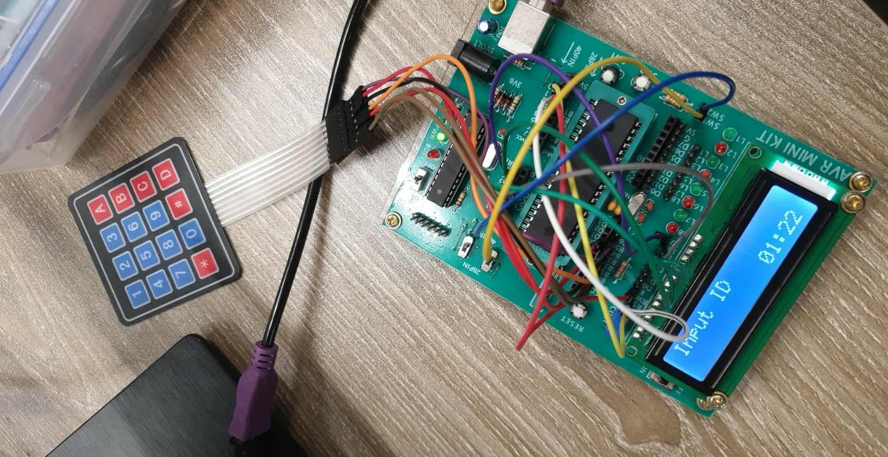
  <br/><em>Fig. 1 – Hardware prototype: AVR mini-kit, 4×3 membrane keypad, 16×2 LCD showing the voting countdown.</em>
</p>

## Abstract

Paper balloting is slow to count and open to human error, which makes low-cost
electronic voting attractive for schools, clubs and small organisations. This
project presents an Electronic Voting Machine (EVM) built around an
**ATmega32** microcontroller, a 4×3 matrix keypad, three push buttons and a
16×2 character LCD. A voter authenticates with a four-digit ID checked against
a stored registry; a per-voter flag guarantees **one vote per ID**. Voting is
bounded by a hardware-timer countdown (Timer1, CTC, 1 Hz). Only an
administrator, authenticated by PIN, can open the session or **pause/resume**
it. At the end the machine reports per-candidate tallies and either the winner
or an explicit tie. The system was designed and verified in Proteus, written in
embedded C (CodeVisionAVR), and demonstrated on hardware. The prototype's
bill of materials totals **৳1,145**.

This repository additionally contributes (i) an executable **behavioural
reference model** of the firmware with 232 automated tests, (ii) a
model-driven **brute-force / lock-out analysis** of the admin PIN, (iii) a
requirements-traceability matrix and (iv) a **design-review** of the firmware
that lists concrete defects and proposed fixes (§8–§9).

**Keywords:** electronic voting machine · ATmega32 · embedded C · keypad
scanning · Timer1 CTC · HD44780 · Proteus · authentication · lock-out policy

---

## Contents

1. [Introduction and objectives](#1-introduction-and-objectives)
2. [System requirements](#2-system-requirements)
3. [Hardware architecture](#3-hardware-architecture)
4. [Firmware design](#4-firmware-design)
5. [Design-space exploration](#5-design-space-exploration)
6. [Verification and results](#6-verification-and-results)
7. [Contribution: executable reference model](#7-contribution-executable-reference-model)
8. [Contribution: security analysis](#8-contribution-security-analysis)
9. [Design review: known issues and proposed fixes](#9-design-review-known-issues-and-proposed-fixes)
10. [Limitations, applications and future work](#10-limitations-applications-and-future-work)
11. [Reproducing the results](#11-reproducing-the-results)
12. [Repository layout](#12-repository-layout)
13. [Authors, references, licence](#13-authors-references-licence)

---

## 1. Introduction and objectives

Elections – national, institutional or a club ballot – depend on three
properties: only eligible people vote, each votes once, and the count is right
and quickly available. The EVM here targets **small-scale elections** where
simplicity, cost and reliability matter more than scale.

Objectives:

- implement a secure, user-friendly EVM on an ATmega32 with keypad and LCD;
- verify voters by unique ID and block repeat voting;
- let **only the administrator** start, pause and resume voting;
- use a hardware timer for real-time monitoring and time-limited voting;
- design and test in Proteus before hardware; program in embedded C;
- keep the design reliable and cost-effective.

## 2. System requirements

Specifications from the project report (Section IV) and where each is
implemented and checked. "Model test" refers to `tests/test_model.py`.

| ID | Requirement | Implementation (`firmware/evm_final.c`) | Evidence |
|----|-------------|------------------------------------------|----------|
| S1 | Store N voter IDs | `voterDb[voterLimit][idLen]`, `voterLimit = 5` | model: `test_valid_vote_counts_once…` |
| S2 | One vote per ID per session | `votedFlags[]` checked before the ballot screen | model: duplicate test + 300-run fuzz invariant |
| S3 | Choose among three candidates by push buttons | `PINA.0/1/2` → `votes[0..2]` (BNP, JMT, NCP) | model: report scenario BNP 1 / JMT 1 / NCP 3 |
| S4 | Prompts, errors and results on a 16×2 LCD | `alcd` driver (see §9, K2 for truncation) | Proteus screenshots §6 |
| S5 | Admin monitor/control | PIN login; `#` + PIN pause; `*` resume | model: pause/resume tests |
| S6 | Keep votes until timer expiry or all votes cast, then show winner | Timer1 ISR countdown; `votesCast >= voterLimit` | model: early-end and timeout tests |
| S7 | Announce winner or "Tie" | `maxVotes` / `maxCount` logic | model: exhaustive over all 216 tallies with 0–5 votes each |

Technical constraints acknowledged in the report: three hardware timers, three
external-interrupt pins, volatile vote storage (lost on power failure), three
candidates on the current design, polling-based keypad and no lock-out after
wrong passwords. Non-technical constraints (environment 0–50 °C, simple
text-only prompts, neutrality of stored data, no live result tracking,
enclosure, low power and modular repair) are discussed in the report.

## 3. Hardware architecture

<p align="center">
  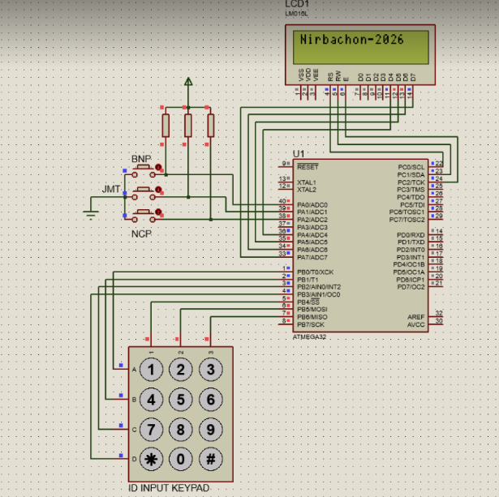
  <br/><em>Fig. 2 – Final Proteus schematic (Design Approach 3, integrated LCD).</em>
</p>

**Pin map** (taken from the firmware port set-up):

| Port | Pins | Direction | Function |
|------|------|-----------|----------|
| PORTA | PA0, PA1, PA2 | input | candidate buttons BNP / JMT / NCP, active-low |
| PORTA | PA4–PA7 | output (`DDRA = 0xF0`) | LCD interface lines |
| PORTB | PB0–PB3 | output (`DDRB = 0x0F`) | keypad rows, driven low one at a time |
| PORTB | PB4–PB6 | input, pull-ups on (`PORTB = 0xF0`) | keypad columns |
| PORTC | all | output (`DDRC = 0xFF`) | LCD control lines |

Supply: regulated 5 V. Timer: Timer1 in CTC mode (§4.2).

**Bill of materials** (from the report, Appendix D; the total is re-checked
here: 400 + 250 + 150 + 45 + 100 + 200 = 1,145):

| Component | Qty | Cost (BDT) |
|-----------|----:|-----------:|
| ATmega32 MCU | 1 | 400 |
| LCD 16×2 | 1 | 250 |
| 4×3 matrix keypad | 1 | 150 |
| Push buttons | 3 | 45 |
| Resistors & wires | – | 100 |
| Power supply (5 V) | 1 | 200 |
| **Total** | | **1,145** |

## 4. Firmware design

The firmware is a single `main()` driving the state machine below plus one
interrupt service routine. It is written in embedded C for CodeVisionAVR and
uses the `alcd` library for the LCD.

<p align="center">
  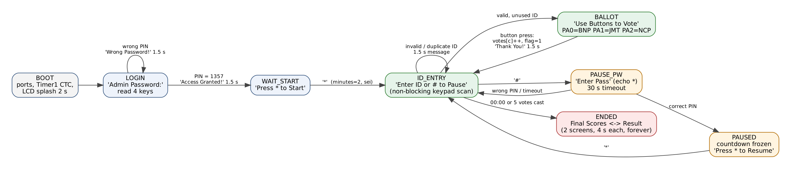
  <br/><em>Fig. 3 – Firmware state machine reconstructed from <code>evm_final.c</code> (green: voting, orange: administrator pause path).</em>
</p>

### 4.1 Input handling

* **Keypad** – `scanKeypad()` drives each row low in turn (`PORTB = ~(1<<row)`),
  waits 10 µs, then reads the three columns. It is *non-blocking* (returns 0 if
  nothing is pressed), which lets the main loop keep refreshing the timer.
  `waitForKeyPress()` is the blocking variant with a release wait to avoid
  repeated reads.
* **Buttons** – three active-low inputs read from `PINA`; a vote is counted on
  the press and the code waits for release before continuing.

### 4.2 Timer derivation

Timer1 runs in CTC mode with prescaler 1024 and `OCR1A = 0x3D08 = 15624`:

```
f_tick = f_CPU / (N · (1 + OCR1A)) = 16 MHz / (1024 · 15625) = 1.000 Hz
```

so the compare-match ISR fires once per second **provided the MCU clock is
16 MHz** (an 8 MHz clock would give a 2 s tick; the Proteus component clock
must be set accordingly). The ISR decrements `minutes:seconds` while voting is
active and not paused, ends voting at 00:00, and decrements `timeoutCounter`,
which bounds the pause-password prompt to 30 ticks.

### 4.3 Session logic

1. **Admin login** – four keys are read and compared with `adminPass`; a miss
   shows *Wrong Password!* for 1.5 s and repeats.
2. **Start** – only `*` starts the session (`minutes = timeLimit`, interrupts
   enabled).
3. **Voter loop** – ID digits are collected one key at a time; on the fourth
   digit the ID is looked up. *Invalid ID* and *Already Voted* are distinct
   messages. A valid, unused ID moves to the ballot screen; a button press
   increments `votes[c]`, sets `votedFlags[i]`, and shows *Thank You!*.
4. **Pause / resume** – `#` opens a password prompt (digits echoed as `*`,
   30 s timeout). A correct PIN freezes the countdown (`isPaused`); `*` resumes.
5. **Results** – when time reaches 00:00 or all registered voters have voted,
   the machine computes `maxVotes`, counts how many candidates reach it, and
   flags a tie if more than one does (or if nobody voted). Two screens – final
   scores and winner/tie – alternate every 4 s indefinitely.

Source: [`firmware/evm_final.c`](firmware/evm_final.c). Earlier iterations
(seven-segment multiplexed display; LCD-only with debounced buttons) are kept
in [`firmware/iterations/`](firmware/iterations/) for provenance.

## 5. Design-space exploration

Three architectures were considered (report, Section VII).

| | Approach 1 – Biometric | Approach 2 – LCD + 7-segment counter | **Approach 3 – Integrated LCD (chosen)** |
|---|---|---|---|
| Voter authentication | fingerprint | keypad ID | keypad ID |
| Extra I/O | sensor interface | ≈ 10 more pins (7 segments + 3 digits) | none |
| CPU load | enrolment/matching algorithms | multiplexing, reported 60–70 % | LCD controller does the refreshing |
| Simulatable in Proteus | no (no sensor model) | yes | yes |
| Outcome | conceptual only: no simulation model, procurement and cost issues | works, but interrupt contention with the timer and keypad scan | implemented, simplest and most reliable |

<p align="center">
  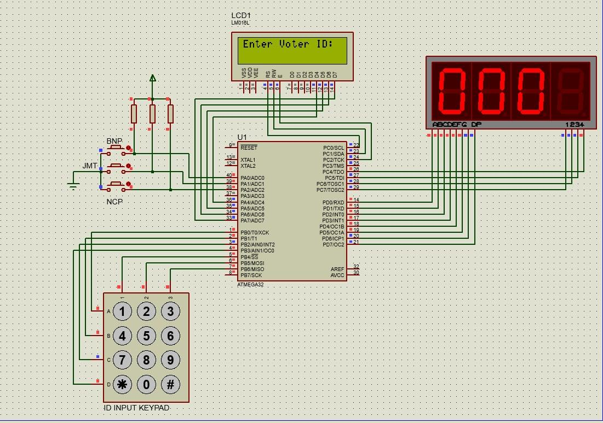
  <br/><em>Fig. 4 – Design Approach 2 (LCD + multiplexed seven-segment counter). The 60–70 % CPU figure is the report's estimate, not re-measured here.</em>
</p>

## 6. Verification and results

The report verified the design in Proteus by running the complete flow. Its
findings: all five registered IDs were accepted, invalid IDs were rejected,
duplicates blocked, every button press incremented the right candidate, the LCD
tally matched the manual count, and a vote was registered in about one second.

> **Provenance note.** The screenshots below come from the report. They show the
> prompt *"Input ID"* and 50 ms-debounced buttons, which match
> `firmware/iterations/iter3_lcd_only_countdown.c`, not the later cleaned-up
> `evm_final.c` printed in the report appendix. Behaviour is broadly equivalent for the
> scenarios shown; §9 lists where the two differ.

<table>
<tr>
<td align="center">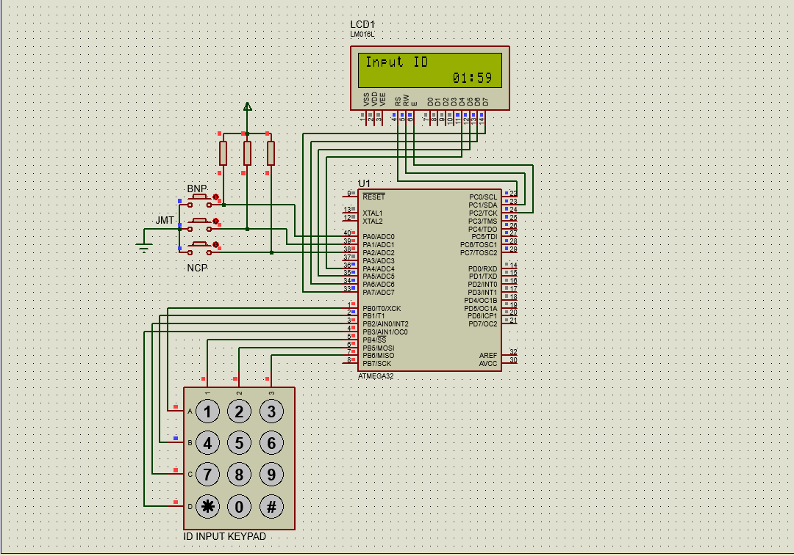<br/><sub>(a) Countdown shown on the ID prompt (01:59)</sub></td>
<td align="center">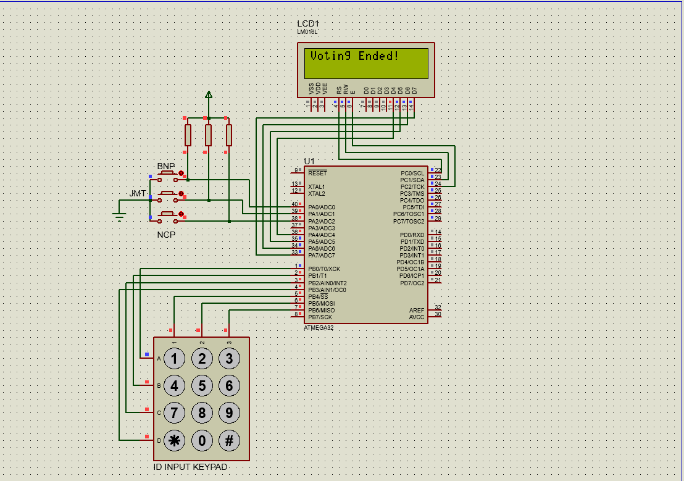<br/><sub>(b) "Voting Ended!" after time-out or last vote</sub></td>
</tr>
<tr>
<td align="center"><br/><sub>(c) Final scores: BNP 1, JMT 1, NCP 3</sub></td>
<td align="center">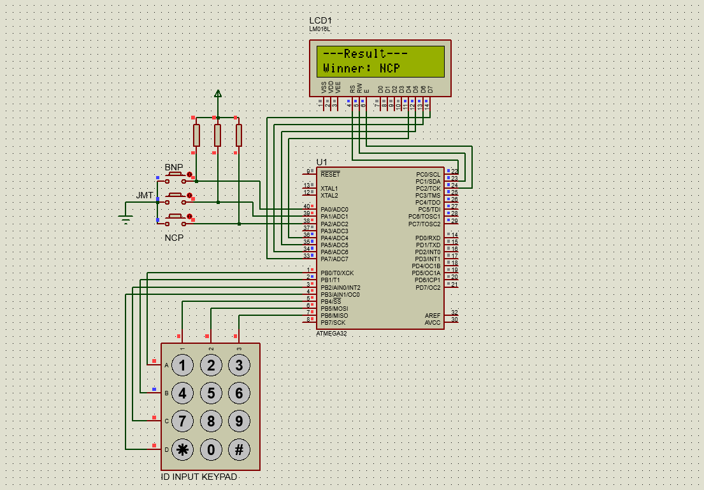<br/><sub>(d) Result: Winner NCP</sub></td>
</tr>
<tr>
<td align="center">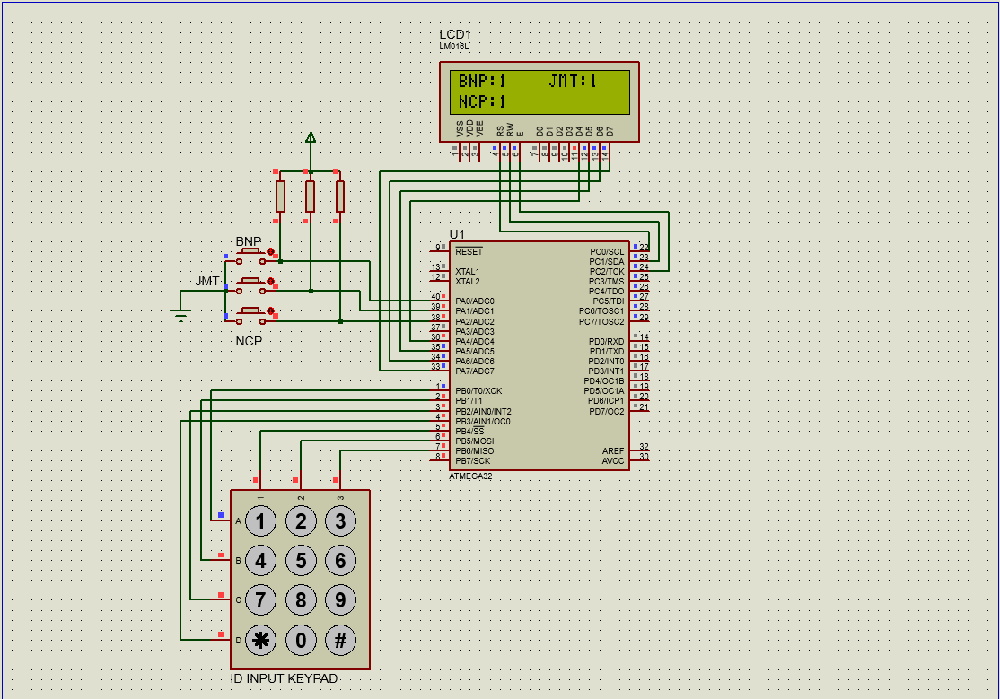<br/><sub>(e) Final scores with no clear winner (1 : 1 : 1)</sub></td>
<td align="center">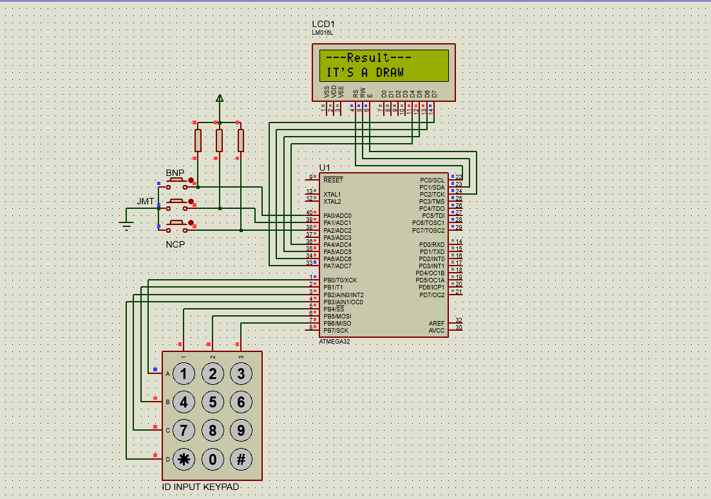<br/><sub>(f) Result: draw/tie declared</sub></td>
</tr>
</table>

<p align="center"><em>Fig. 5 – Proteus runs of the voting flow and both result branches.</em></p>

### Flowcharts

<table>
<tr>
<td align="center" valign="top">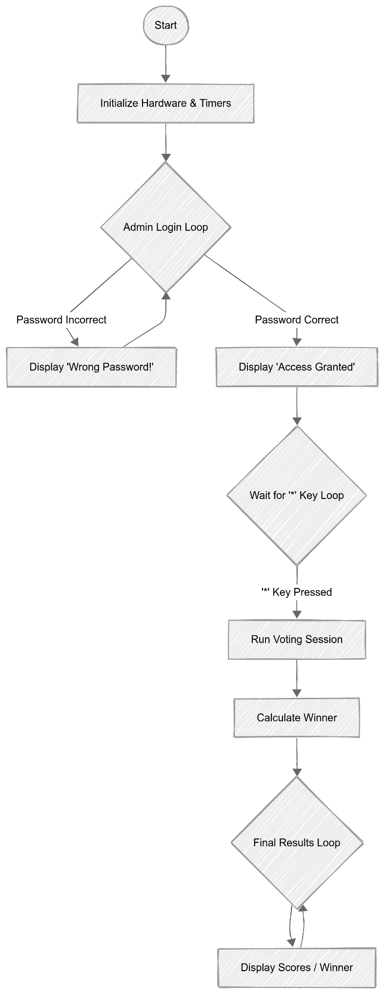<br/><sub>Overall</sub></td>
<td align="center" valign="top">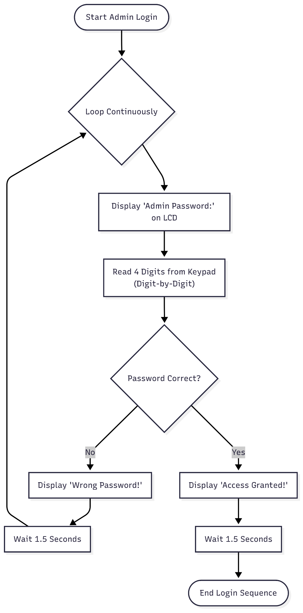<br/><sub>Admin login</sub></td>
<td align="center" valign="top">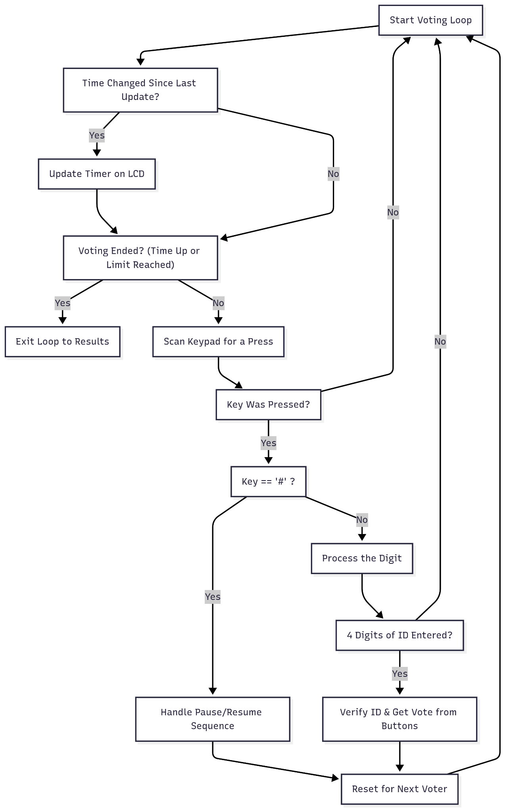<br/><sub>Voting session</sub></td>
<td align="center" valign="top">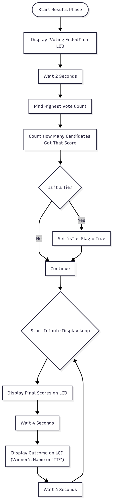<br/><sub>Results</sub></td>
</tr>
</table>

The detailed per-voter loop is in
[`docs/figures/flowchart_voting_loop_detail.png`](docs/figures/flowchart_voting_loop_detail.png).

## 7. Contribution: executable reference model

[`model/evm_model.py`](model/evm_model.py) is a behavioural model of
`evm_final.c`: it reproduces the control flow, the 1 Hz ISR, the
`timeoutCounter`, and the blocking `delay_ms(1500)` windows during which key
presses are lost. It is **not** a bit-accurate emulator and it is not a
substitute for the Proteus run; it exists so that the system-level claims can
be regression-tested.

`pytest` runs **232 tests**: login, start gating, dropped keys during delays,
single-vote enforcement, invalid and `*`-containing IDs, the report's own
result scenarios, **exhaustive winner/tie logic over all 6³ = 216 tallies**,
pause freeze/resume, pause time-out, early session end, a 300-run randomised
fuzz test of the invariant *Σ votes = votes cast = number of voters flagged ≤
registry size*, and the optional lock-out policy of §8.

## 8. Contribution: security analysis

**Attacker model.** Physical access to the keypad only; knows the PIN is four
decimal digits (10⁴ candidates) and guesses without repetition; needs
*t_key* seconds per key. Two attack surfaces exist: the pre-session login
(unlimited time, 1.5 s penalty per miss) and the in-session pause prompt (open
only while voting runs, ≈ 119 s). Numbers below are produced by
[`analysis/bruteforce.py`](analysis/bruteforce.py), which drives the reference
model (so delay windows and lost keystrokes are included), at *t_key* = 0.3 s.

| Policy | E[time to recover PIN], login | Worst case | Attempts in voting window | P(recover PIN in window) |
|--------|------:|------:|------:|------:|
| **Firmware as shipped** (none) | **3.3 h** | 6.7 h | 44 | 0.44 % |
| Lock-out: 3 misses → 30 s, doubling, cap 15 min | 418 h (17 d) | 838 h | 9 | 0.09 % |
| Lock-out: 3 misses → 60 s, doubling, cap 1 h | 1,664 h (69 d) | 3,333 h | 6 | 0.06 % |

<p align="center">
  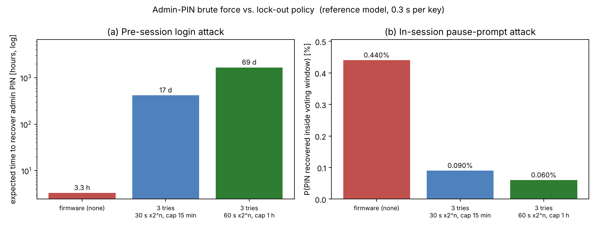
  <br/><em>Fig. 6 – Effect of an escalating lock-out on admin-PIN brute force (model-driven).</em>
</p>

The report itself lists the missing lock-out as a limitation; this analysis
quantifies it. At the shipped behaviour a patient attacker recovers the PIN in
a few hours on average, while a three-strike escalating lock-out raises that by
two to three orders of magnitude at the cost of a few lines of firmware.
Sensitivity to typing speed (0.15–0.6 s per key) is in
[`analysis/bruteforce_results.json`](analysis/bruteforce_results.json): the
shipped policy ranges from 2.7 h to 4.6 h; the lock-out policies are
insensitive because the lock-out time dominates.

Other security observations: the demo registry uses sequential IDs
(`1111…5555`), so an insider can enumerate it in five tries; the PIN and IDs
are compile-time constants (changing them requires re-flashing); and the vote
tally is held only in RAM (no tamper evidence, no audit log).

## 9. Design review: known issues and proposed fixes

Findings from reading `firmware/evm_final.c` against the report. These come
from code inspection and the reference model; items marked ⚠ affect displayed
output or robustness and should be confirmed in Proteus/hardware before
fixing. The original firmware is left unmodified.

| # | Finding | Why it matters | Proposed fix |
|---|---------|----------------|--------------|
| K1 ⚠ | On the *Final Scores* screen the second line is written twice: `BNP:%-4d JMT:%-4d` at (0,1), then `lcd_gotoxy(0,1)` and `NCP:%d` overwrite its first characters. | The BNP count is overwritten by the NCP count on the display. (The report's screenshots come from iteration 3, which put BNP/JMT on line 1 and NCP on line 2.) | Print `BNP:%d JMT:%d` on line 1 and `NCP:%d` on line 2, as in iteration 3. |
| K2 ⚠ | Several strings exceed 16 columns: `"Enter ID or # to Pause"` (22), `"---Final Scores---"` (18), `"Press '*' to Resume"` (19), `"Use Buttons to Vote"` (19). | The HD44780's visible window is 16 characters; the tail is clipped. | Shorten to ≤ 16 characters (e.g. `"ID  or # pause"`). |
| K3 | `#define btnPort PINA` is used as `btnPort = 0x07`, i.e. a write to the *input* register rather than `PORTA`. | The internal pull-ups are not enabled by that line. The circuit still works because the schematic has external pull-up resistors on all three buttons. (Check the ATmega32 datasheet's PINx behaviour.) | `#define btnPort PORTA` for output writes; keep `PINA` for reads. |
| K4 | The admin PIN is echoed in clear at login (`lcd_putchar(key)`), whereas the pause prompt masks digits with `*`. | Shoulder-surfing risk at set-up. | Echo `*` in the login loop too. |
| K5 | No lock-out after wrong PINs (acknowledged in the report). | §8: PIN recoverable in hours. | Count consecutive failures; apply the escalating delay validated in §8. |
| K6 | Timer1's compare flag is latched during login; `sei()` therefore triggers one ISR immediately. | The model predicts the 2:00 budget is consumed one tick early: the voting window is between **118 s and 119 s**, not 120 s. | Clear `OCF1A` (write 1 to it) or reset `TCNT1` just before `sei()`. Confirm in Proteus first. |
| K7 | The report describes 50 ms software debouncing; `evm_final.c` has none, iteration 3 does. | Docs and code disagree. Single-vote integrity is still preserved because the loop `break`s on the first detected press and then waits for release. | Restore the debounce or amend the report text. |
| K8 | Once a valid ID reaches the ballot screen, there is no time-out or pause. | A voter can hold the session open after 00:00 until a button is pressed. | Add a ballot time-out that returns to the ID prompt without counting a vote. |

## 10. Limitations, applications and future work

**Limitations (from the report).** Three candidates only; small, hard-coded
voter database in microcontroller memory; votes lost on power failure; keypad
polling plus debounce can miss very fast or simultaneous presses; results
cannot be shared remotely; suitable for small-scale elections only.

**Applications.** School and club elections, student councils, board or
cooperative votes, audience polling at events, quick opinion or feedback
polls.

**Future work.** Votes in EEPROM or an SD card with a hash-chained audit log;
password-attempt lock-out (§8) and masked PIN entry; run-time voter
registration; more candidates (matrix of buttons or a menu); wireless result
transfer; multi-language and tactile/braille accessibility; battery or solar
backup; biometric authentication where hardware allows.

## 11. Reproducing the results

```bash
# reference model + tests (Python 3.9+)
pip install -r requirements.txt
python -m pytest -q                    # 232 passed

# security analysis and figure (≈ 10 s)
python analysis/bruteforce.py

# state-machine figure (needs Graphviz)
dot -Tpng -Gdpi=150 docs/fsm.dot -o docs/figures/firmware_fsm.png
```

**Hardware/simulation.** Open `simulation/proteus/EVM_Group02.pdsprj` in
Proteus 8, compile `firmware/evm_final.c` for ATmega32 at **16 MHz** with
CodeVisionAVR (`alcd` LCD library, 16×2) and load the resulting HEX into U1.

## 12. Repository layout

```
firmware/
  evm_final.c                      final firmware (from the report appendix)
  iterations/                      earlier CodeVisionAVR iterations (provenance)
simulation/proteus/                Proteus project (final circuit)
model/evm_model.py                 behavioural reference model
tests/test_model.py                232 automated tests
analysis/bruteforce.py             model-driven PIN brute-force analysis
analysis/bruteforce_results.json   numerical results (3 typing speeds)
docs/fsm.dot                       state-machine source (Graphviz)
docs/figures/                      figures used in this README
```

## 13. Authors, references, licence

**Contributors:** Intisar, Nusrat, Sinan, Farhan and Iftekhar.

**References**

1. Microchip Technology Inc., *ATmega32 8-bit AVR Microcontroller Datasheet*.
2. Hitachi, *HD44780U LCD Controller/Driver Datasheet (LM016L LCD module)*.
3. Labcenter Electronics, *Proteus Design Suite*.
4. HP InfoTech, *CodeVisionAVR C compiler*.

**Licence.** [MIT](LICENSE). The reference model, tests and analysis were
added after the original coursework to document and stress-test it; they are
not part of the graded submission.
